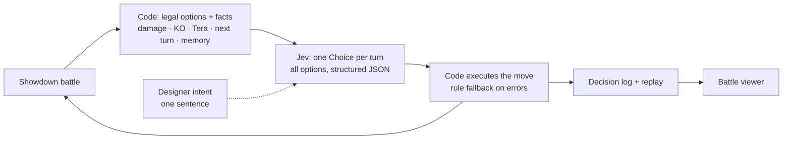

<div align="center">

# JEV PLAYS POKéMON SHOWDOWN

**Code computes the facts. [Jev](https://docs.typesafe.ai) picks the move. One sentence steers it.**

[English](README.md) · [简体中文](README.zh-CN.md) · [Website](https://zdhgreat.github.io/pokejev/) · [Docs](docs/)


<sub>A real battle. Left: the Pokémon Showdown replay. Right: every legal option with the facts code computed,
and Jev's probability for each.</sub>

</div>

## Videos

| | |
|---|---|
| **Jev plays a battle** | [demo-battle.mp4](docs/media/demo-battle.mp4) |
| **Steering with a designer intent** | [demo-steering.mp4](docs/media/demo-steering.mp4) |
| **From zero to your first battle** (setup) | [setup-walkthrough.mp4](docs/media/setup-walkthrough.mp4) |

## What it is

A Pokémon battle AI for [Pokémon Showdown](https://github.com/smogon/pokemon-showdown) where the work is split:

- **Code computes the facts** for every legal move and switch:
  - estimated damage (Showdown's own calculator), KO, type effectiveness;
  - Tera variants and speed;
  - the opponent's best reply;
  - a short memory of the last turns.
- **Jev chooses**, TypeSafe's "System One" decision model: one Choice question per turn, with every option visible
  in one structured state. It returns a probability for each option.
- **A designer can steer it in plain text**, e.g. *"Never use a move that lowers our own stats unless it knocks
  out the opponent."* No branches, no rule code, English or Chinese.

## Results

| | |
|---|---|
| Win rate vs poke-env's heuristic bot | **69%**|
| Intent followed, live, on turns where the plain rule would break it | **97%** (0.4% broken elsewhere) |
| Head-to-head vs other public Jev agents | **24–12** and **18–5** |
| Cost per battle · median decision time | about **$0.0014** · about **1 s** |

Full numbers and method: [results/RESULTS.md](results/RESULTS.md) · [docs/evaluation.md](docs/evaluation.md).

## Quick start

1. **Start a local Pokémon Showdown server** (Node.js):

   ```bash
   git clone https://github.com/smogon/pokemon-showdown
   cd pokemon-showdown
   node pokemon-showdown start --no-security
   ```

2. **Install this project** (Python 3.10+), in another terminal:

   ```bash
   git clone https://github.com/zdhgreat/pokejev
   cd pokejev
   pip install -r requirements.txt
   ```

3. **Run a free practice battle and open the viewer.** No key needed; the answers are random.

   ```bash
   python -m pokejev demo
   ```

4. **Play with real Jev**, using your TypeSafe key (about $0.0015 per battle):

   ```bash
   export TYPESAFE_API_KEY=...
   python -m pokejev demo --real
   ```

## How it works



One option exactly as Jev saw it, from a real demo battle:

```json
"Extreme Speed": {"action": "physical move (normal)", "effectiveness": "1x (neutral)",
  "damage_pct_of_opponent_hp": 46.5, "likely_ko": false, "accuracy_pct": 100, "priority": 2,
  "used_in_a_row": 1, "properties": [],
  "next_turn": {"we_move_first": true, "opponent_best_reply": "Hydro Pump",
                "reply_damage_pct_of_our_hp": 71.7, "reply_likely_ko_us": true, "we_ko_before_reply": false}}
```

**Why code computes:** TypeSafe documents that Jev is not a calculator. In our probes it was at 100% on comparisons
and logic over *stated* numbers, but unreliable at multi-step references and long counts. So numbers are computed;
Jev compares and judges. More in [docs/how-it-works.md](docs/how-it-works.md).

## The battle viewer

```bash
python -m pokejev view runs/<run>
```

It writes one HTML file per run:
- the real battle in a Game Boy-style frame (Pokémon Showdown's replay player);
- Jev's decision for the same turn: every option, its facts, Jev's probability, Jev's choice and the rule's pick;
- in steering mode, whether the intent was followed.

Controls: play/pause (space), step (← →), timeline, battle selector.


## Steer it with one sentence

```bash
python -m pokejev intents                                    # 20 example intents
python -m pokejev play --decider jev --intent ha02 --battles 3 --out runs/ha02
python -m pokejev eval runs/ha02                             # compliance on conflict turns
```

A **conflict turn** is one where the plain rule's own move would break the intent, so a decider that ignores the
intent can't look compliant for free. To write your own intents (and the checker that measures them), see
[docs/writing-intents.md](docs/writing-intents.md).

## Commands

| Command | What it does |
|---|---|
| `python -m pokejev demo [--real] [--intent ID]` | one battle, then opens the viewer |
| `python -m pokejev play --decider jev\|rule [--intent ID] [--version v01..v4] --battles N --out DIR` | play N battles against poke-env's heuristic bot |
| `python -m pokejev eval DIR` | win rate, play quality, intent compliance |
| `python -m pokejev view DIR` | build and open the battle viewer |
| `python -m pokejev intents` | list the designer intents |

Options:
- `--stub` uses random answers (free);
- `--budget` stops calling Jev at a spend cap and falls back to the rule.

**Versions:**

| Version | Features |
|---|---|
| `v01` | the original agent |
| `v1` | + Tera + calculator |
| `v2` | + next-turn facts |
| `v3` | + two-stage shortlist |
| **`v4`** (default) | v2 + memory |

## Project layout

```
pokejev/facts.py      code-computed facts (damage, KO, Tera, opponent threat, memory inputs)
pokejev/render.py     the structured state and the Choice question Jev receives
pokejev/decider.py    JevDecider (one or two stages) and the rule baseline
pokejev/player.py     poke-env player: build facts, ask, execute, log, save replays
pokejev/viewer.py     the battle viewer (single HTML file)
pokejev/intents.py    designer intents with exact checkers
pokejev/evaluate.py   win rate, quality, conflict-turn compliance
scripts/make_videos.py  renders the demo videos (headless Chrome + FFmpeg)
docs/                   website (index.html), guides, media
```

Run the tests (offline: no server, no network):

```bash
python -m unittest discover -s tests -v
```

## Limits

- **One game.** Tested against poke-env's heuristic bot and a few public Jev agents; random battles only.
- **Online API.** About 1 s per decision, so it suits turn-based play, not frame-level control.
- **Fact gaps.** Abilities, items, weather and terrain are only covered when Showdown's calculator runs (87% of
  calls); entry hazards on switch-in and opponent-set prediction are not modelled.
- **The viewer's battle screen needs internet.** It loads Showdown's replay player; the decision panel works
  offline.

## Related work

- **Other public Jev Showdown agents:**
  - [NatBrian/pokemon-showdown-jev-agent](https://github.com/NatBrian/pokemon-showdown-jev-agent);
  - [izzuddin8803/jev-showdown](https://github.com/izzuddin8803/jev-showdown);
  - [xtolol/Porygon-Jev](https://github.com/xtolol/Porygon-Jev);
  - [neurogabo/jev-arena](https://github.com/neurogabo/jev-arena).

  Head-to-head results and the ideas we adapted are in [results/RESULTS.md](results/RESULTS.md); no code was
  copied.
- **Broader Pokémon battle AI:** PokéChamp (LLM + minimax), Metamon and the PokéAgent Challenge (RL), foul-play
  (search).

## License and credits

MIT (see [LICENSE](LICENSE)).
- **Pokémon Showdown** (MIT) and **poke-env** (MIT) are external dependencies.
- **The battle screen** is Pokémon Showdown's replay player, loaded from play.pokemonshowdown.com when you open the
  viewer. No Pokémon artwork is included in this repository.
- **Jev** is a commercial API by TypeSafe.
- **Font:** Press Start 2P (SIL OFL).

Not affiliated with TypeSafe, Smogon, Nintendo, Game Freak or The Pokémon Company. Pokémon is a trademark of its
respective owners.
