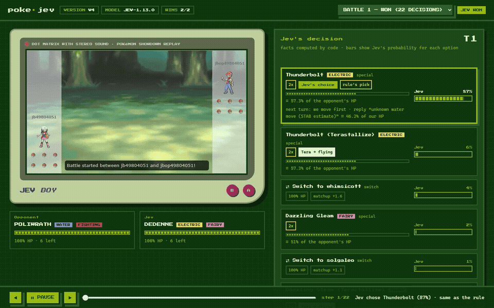
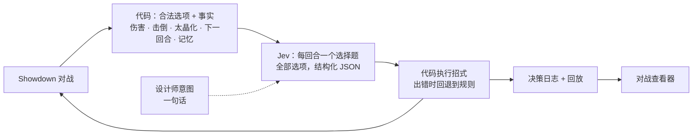
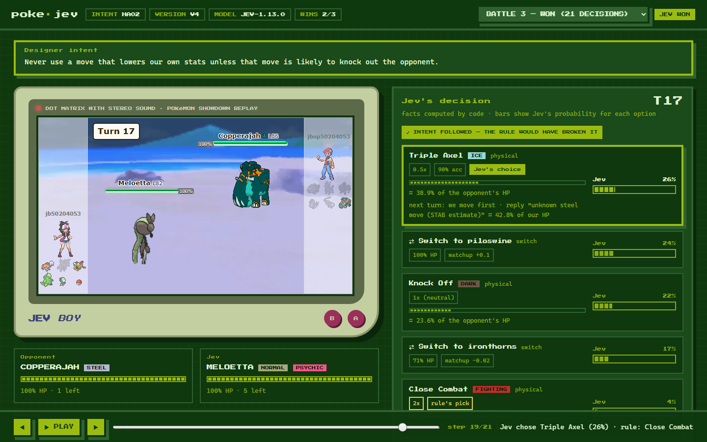

<div align="center">

# JEV 玩宝可梦对战（Pokémon Showdown）

**代码负责计算事实，[Jev](https://docs.typesafe.ai) 负责选招，一句话就能操控它的打法。**

[English](README.md) · [简体中文](README.zh-CN.md) · [项目主页](https://zdhgreat.github.io/pokejev/) · [文档](docs/)




<sub>一场真实对战。左侧：Pokémon Showdown 对战回放；右侧：代码为每个合法选项算出的事实，以及 Jev 给每个选项的概率。</sub>

</div>

## 演示视频

| | |
|---|---|
| **Jev 打一场对战** | [demo-battle.mp4](docs/media/demo-battle.mp4) |
| **用一句话操控打法** | [demo-steering.mp4](docs/media/demo-steering.mp4) |
| **从零开始到第一场对战**（安装演示） | [setup-walkthrough.mp4](docs/media/setup-walkthrough.mp4) |

## 这是什么

一个运行在 [Pokémon Showdown](https://github.com/smogon/pokemon-showdown) 上的宝可梦对战 AI，分工如下：

- **代码计算事实**，覆盖每个合法招式和换人：
  - 预估伤害（Showdown 自带的伤害计算器）、能否击倒、属性克制；
  - 太晶化选项和速度；
  - 对手的最佳回击；
  - 最近几回合的简短记忆。
- **Jev 做选择**：Jev 是 TypeSafe 的 "System One" 决策模型。每回合只问一个选择题，所有选项都放在同一个结构化状态里，Jev 返回每个选项的概率。
- **设计师可以用自然语言操控它**，例如 *"不要使用会降低自身能力的招式，除非它能击倒对手。"* 不需要写分支或规则代码，中英文都可以。

## 结果

| | |
|---|---|
| 对 poke-env 启发式机器人的胜率 | **69%** |
| 实战意图遵从率（只统计规则本会违反意图的回合） | **97%**（其他回合误破坏 0.4%） |
| 与其他公开 Jev 智能体正面对战 | **24–12**、**18–5** |
| 每局成本 · 决策耗时中位数 | 约 **$0.0014** · 约 **1 秒** |

完整数据与方法见 [results/RESULTS.md](results/RESULTS.md) 和 [docs/evaluation.md](docs/evaluation.md)。

## 快速开始

1. **启动本地 Pokémon Showdown 服务器**（需要 Node.js）：

   ```bash
   git clone https://github.com/smogon/pokemon-showdown
   cd pokemon-showdown
   node pokemon-showdown start --no-security
   ```

2. **安装本项目**（Python 3.10+），在另一个终端中运行：

   ```bash
   git clone https://github.com/zdhgreat/pokejev
   cd pokejev
   pip install -r requirements.txt
   ```

3. **免费试玩一局并打开查看器**。不需要密钥，此时的选择是随机的：

   ```bash
   python -m pokejev demo
   ```

4. **使用真正的 Jev**，需要你自己的 TypeSafe 密钥，每局约 $0.0015：

   ```bash
   export TYPESAFE_API_KEY=...
   python -m pokejev demo --real
   ```

## 工作原理



下面是一场真实演示对战中，Jev 看到的某个选项（原样摘录）：

```json
"Extreme Speed": {"action": "physical move (normal)", "effectiveness": "1x (neutral)",
  "damage_pct_of_opponent_hp": 46.5, "likely_ko": false, "accuracy_pct": 100, "priority": 2,
  "used_in_a_row": 1, "properties": [],
  "next_turn": {"we_move_first": true, "opponent_best_reply": "Hydro Pump",
                "reply_damage_pct_of_our_hp": 71.7, "reply_likely_ko_us": true, "we_ko_before_reply": false}}
```

**为什么由代码计算：** TypeSafe 的文档明确说明 Jev 不是计算器。在我们的测试中，只要数字已经写在输入里，它做比较和逻辑判断的准确率是 100%；但多步指代和长列表计数不可靠。所以数字由代码算好，Jev 只负责比较和判断。详见 [docs/how-it-works.md](docs/how-it-works.md)。

## 对战查看器

```bash
python -m pokejev view runs/<run>
```

每次运行生成一个 HTML 文件：
- 游戏机风格边框里的真实对战画面（Pokémon Showdown 回放播放器）；
- 同一回合 Jev 的决策：每个选项、它的事实、Jev 的概率、Jev 的选择和规则的选择；
- 操控模式下，还会显示意图是否被遵守。

操作：播放/暂停（空格）、逐步（← →）、时间轴、对局切换。



## 一句话操控

```bash
python -m pokejev intents                                    # 20 个示例意图
python -m pokejev play --decider jev --intent ha02 --battles 3 --out runs/ha02
python -m pokejev eval runs/ha02                             # 冲突回合的遵从率
```

**冲突回合**是指：如果按普通规则选招就会违反意图的回合。只在这些回合统计遵从率，忽略意图的决策者就无法白白拿到高分。如何编写自己的意图（以及衡量它的检查函数），见 [docs/writing-intents.md](docs/writing-intents.md)。

## 命令一览

| 命令 | 作用 |
|---|---|
| `python -m pokejev demo [--real] [--intent ID]` | 打一局，然后打开查看器 |
| `python -m pokejev play --decider jev\|rule [--intent ID] [--version v01..v4] --battles N --out DIR` | 与 poke-env 启发式机器人对战 N 局 |
| `python -m pokejev eval DIR` | 胜率、出招质量、意图遵从率 |
| `python -m pokejev view DIR` | 生成并打开对战查看器 |
| `python -m pokejev intents` | 列出设计师意图 |

参数：
- `--stub` 使用随机答案（免费）；
- `--budget` 达到花费上限后停止调用 Jev，回退到规则。

**版本：**

| 版本 | 功能 |
|---|---|
| `v01` | 最初版本 |
| `v1` | + 太晶化 + 伤害计算器 |
| `v2` | + 下一回合事实 |
| `v3` | + 两阶段候选 |
| **`v4`**（默认） | v2 + 记忆 |

## 目录结构

```
pokejev/facts.py      代码计算的事实（伤害、击倒、太晶化、对手威胁、记忆）
pokejev/render.py     Jev 收到的结构化状态与选择题
pokejev/decider.py    JevDecider（一阶段或两阶段）与规则基线
pokejev/player.py     poke-env 玩家：计算事实、提问、执行、记录、保存回放
pokejev/viewer.py     对战查看器（单个 HTML 文件）
pokejev/intents.py    设计师意图及其精确检查函数
pokejev/evaluate.py   胜率、出招质量、冲突回合遵从率
scripts/make_videos.py  生成演示视频（无头 Chrome + FFmpeg）
docs/                   网站（index.html）、指南、媒体文件
```

运行测试（离线，不需要服务器和网络）：

```bash
python -m unittest discover -s tests -v
```

## 局限

- **只测了一种游戏。** 对手是 poke-env 启发式机器人和几个公开的 Jev 智能体，模式只有随机对战。
- **依赖在线 API。** 每次决策约 1 秒，适合回合制，不适合逐帧控制。
- **事实层有缺口。** 特性、道具、天气和场地只有在 Showdown 计算器能运行时才会被计入（87% 的调用）；换人时的场地陷阱伤害和对手配招预测尚未建模。
- **查看器的对战画面需要联网。** 它会加载 Showdown 的回放播放器；决策面板离线也能用。

## 相关项目

- **其他公开的 Jev Showdown 智能体：**
  - [NatBrian/pokemon-showdown-jev-agent](https://github.com/NatBrian/pokemon-showdown-jev-agent)；
  - [izzuddin8803/jev-showdown](https://github.com/izzuddin8803/jev-showdown)；
  - [xtolol/Porygon-Jev](https://github.com/xtolol/Porygon-Jev)；
  - [neurogabo/jev-arena](https://github.com/neurogabo/jev-arena)。

  正面对战结果和借鉴的思路见 [results/RESULTS.md](results/RESULTS.md)，未复制任何代码。
- **更广泛的宝可梦对战 AI：** PokéChamp（大模型 + 极小化极大搜索）、Metamon 与 PokéAgent Challenge（强化学习）、foul-play（搜索）。

## 许可与致谢

MIT 许可，见 [LICENSE](LICENSE)。
- **Pokémon Showdown**（MIT）和 **poke-env**（MIT）为外部依赖。
- **对战画面**来自 Pokémon Showdown 的回放播放器，在你打开查看器时从 play.pokemonshowdown.com 加载。本仓库不包含任何宝可梦美术资源。
- **Jev** 是 TypeSafe 的商业 API。
- **字体：** Press Start 2P（SIL OFL）。

本项目与 TypeSafe、Smogon、任天堂、Game Freak、The Pokémon Company 均无关联。Pokémon 为其各自所有者的商标。
